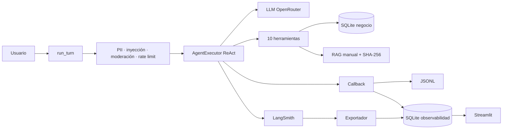
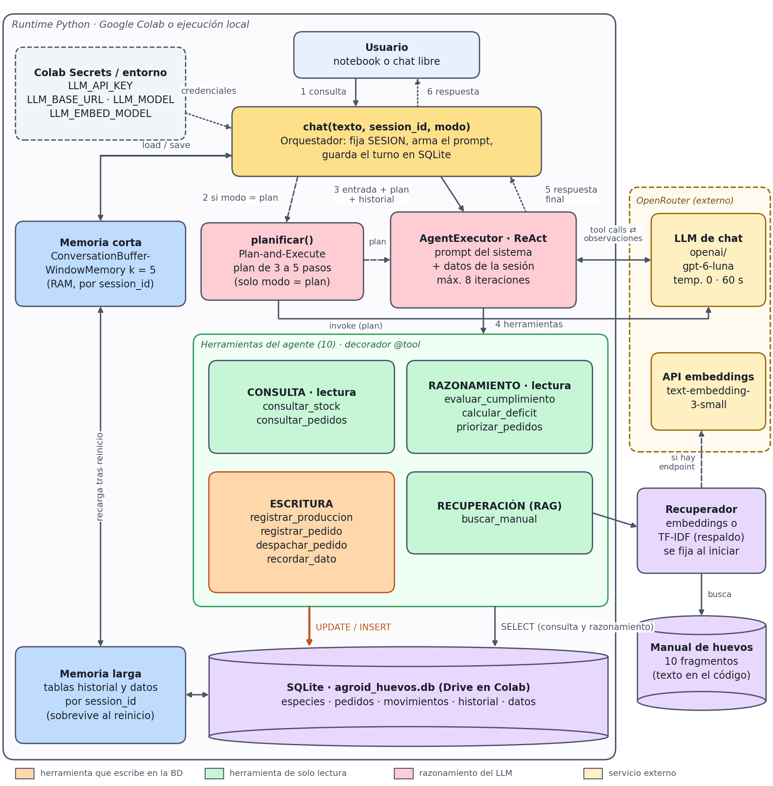
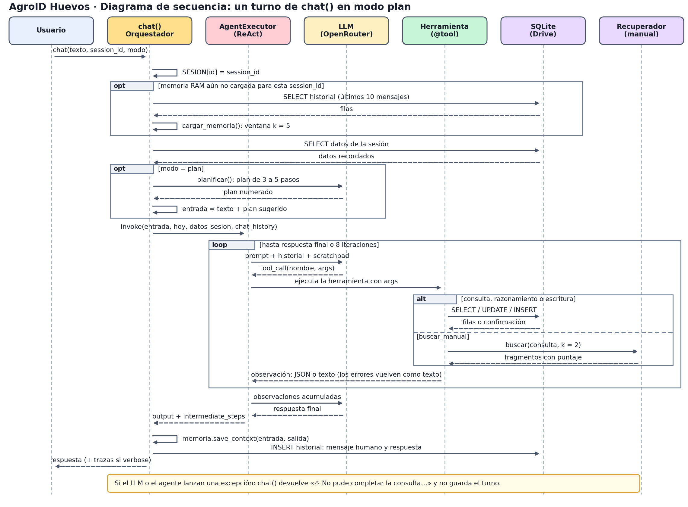
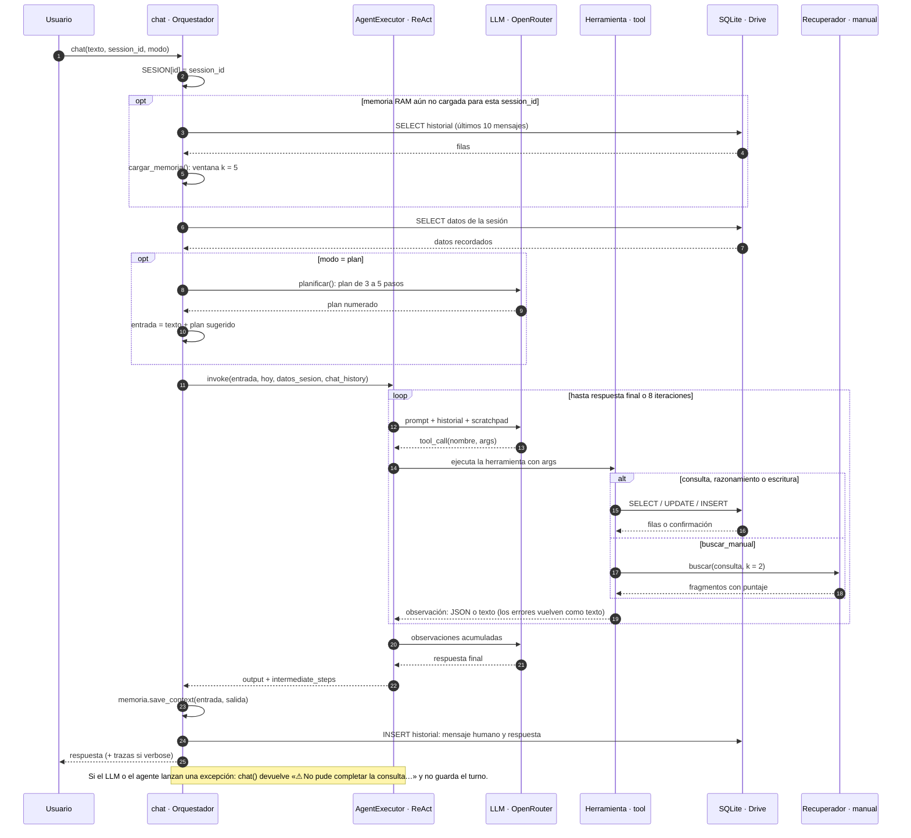

# AgroID Huevos — Agente de inventario con RAG híbrido, planificación adaptativa y observabilidad

Proyecto de la **Evaluación Final Transversal (EFT) de ISY0101**. El agente conversacional en español consulta y actualiza inventario de huevos, revisa pedidos, calcula déficit, prioriza entregas y recupera información de un manual interno **y de un corpus técnico externo citado**. La EFT agrega prompts versionados, RAG híbrido, memoria con resumen, planificación adaptativa, observabilidad, seguridad y un notebook autocontenido.

**Integrantes:** Esteban Pacheco Vega y Javier Perez Mora  
**Sección:** 007D  
**Caso:** AgroID Huevos, PYME avícola verosímil con datos simulados  
**Notebook EFT:** [`AgroID_Huevos_EFT.ipynb`](AgroID_Huevos_EFT.ipynb)  
**Informe EFT:** [`docs/INFORME_EFT.md`](docs/INFORME_EFT.md) · [`docs/INFORME_EFT.pdf`](docs/INFORME_EFT.pdf)  
**Defensa:** [`docs/defensa_eft/`](docs/defensa_eft/) · [`diapositivas.pptx`](docs/defensa_eft/diapositivas.pptx) (15 láminas, notas y tiempos)  
**Chat web:** [`agroid/chat_app.py`](agroid/chat_app.py) · `Abrir_Chat.bat` → `http://localhost:8502`  
**Evidencia EFT:** [`docs/evidencias_eft/`](docs/evidencias_eft/)  
**Checklist de entrega:** [`docs/CHECKLIST_ENTREGA_EFT.md`](docs/CHECKLIST_ENTREGA_EFT.md)

> Datos de inventario simulados. El caso es verosímil y no corresponde a un cliente real. No usar para gestionar una operación avícola real sin validar datos, reglas, fuentes y contenido técnico.

## Chat web

Para conversar con el agente sin usar terminal:

1. Doble clic en `Abrir_Chat.bat` (solo chat) o `Abrir_AgroID.bat` (chat + dashboard).
2. Se abre `http://localhost:8502`.
3. Elige modo `auto`, `react` o `plan`; modelo Nemotron, free o simulado.
4. Escribe la consulta y pulsa **Enviar consulta**.
5. Cada respuesta muestra tools, tokens, plan, fuentes RAG y trace.

El lanzador deja una consola minimizada por cada servidor. **No la cierres mientras uses la app**; para apagarla, cierra esas ventanas o presiona `Ctrl+C`.

La app usa `run_turn` y las mismas herramientas del agente. No es un mockup. Las escrituras modifican la base de demostración; usa **Datos de demo → Restaurar datos de demo** para volver al estado inicial.

## EFT · Qué incluye

- **Caso organizacional:** contexto, procesos, stakeholders, requerimientos, desafíos y KPIs.
- **Prompts versionados:** catálogo `system_v2`, `planner_v2`, `monitor`, `critic`, `rag_answer`, con rúbrica y regresión funcional.
- **RAG interno + externo:** 10 fragmentos internos + 14 externos citados (FAO, USDA, Codex, UGA, American Egg Board, INIA), con SHA-256/HMAC y citas `[Mxx]`/`[Exx]`.
- **Agente funcional:** 10 herramientas de consulta, escritura, razonamiento y recuperación.
- **Memoria:** ventana corta, resumen rodante y hechos persistentes por `session_id`.
- **Planificación adaptativa:** clasificador, plan con criterios de éxito, monitor, replanificación acotada y política de escritura.
- **Observabilidad:** LangSmith, JSONL, SQLite, dashboard Streamlit de 7 pestañas, métricas de calidad, latencia, consistencia, costo, RAG, prompts y planificación.
- **Seguridad:** PII, inyección, moderación, rate limiting, integridad del corpus y bloqueo de fuga del prompt.
- **Notebook autocontenido:** ejecuta el paquete y los datos en Colab/Jupyter, con modo simulado sin API keys.

## EFT · Resultados principales

| Corrida | Turnos | Éxito | Score | Tool match | Groundedness | Citas | Tokens | Costo real |
|---|---:|---:|---:|---:|---:|---:|---:|---:|
| EFT real (`nemotron-3.5-lightning:free`) | 8 | 7 + 1 bloqueado | 0,956 | 0,938 | 0,810 | 0,667 | 40.432 | USD 0 |
| EP3 real (29 turnos) | 29 | 29/29 | 0,970 | 0,943 | 0,926 | — | 139.773 | USD 0 |
| RAG híbrido (10 consultas) | — | — | recall@3 0,867 | — | — | 9/10 con fuente externa | — | — |
| Prompt v2 vs v1 | — | — | rúbrica 1,00 vs 0,90 | — | — | — | — | — |

La corrida real EFT usó `nvidia/nemotron-3.5-lightning:free`. El costo real fue USD 0; el costo equivalente (modelo pagado de referencia) fue USD 0,0064. La comparación con un modelo de gama alta quedó preparada en la suite `validation` (`LLM_MODEL_STRONG`), pero no se ejecutó para no incurrir en costo.

## EFT · Inicio rápido

```powershell
python -m venv .venv
.\.venv\Scripts\Activate.ps1
python -m pip install -r requirements.txt
Copy-Item .env.example .env
# Completa LLM_API_KEY y, si quieres LangSmith, LANGSMITH_API_KEY.
```

Sin API keys, el notebook y las suites simuladas funcionan igual:

```powershell
python tests/run_all.py
python -m agroid.benchmarks.run --mode sim --suite eft
python -m agroid.benchmarks.rag_eval
python -m agroid.benchmarks.prompt_eval
python -m agroid.benchmarks.planning_eval
python -m agroid.cli eft
streamlit run agroid/dashboard/app.py
```

Con API key y cuota free:

```powershell
python -m agroid.benchmarks.run --mode real --suite eft --limit 8 --model nvidia/nemotron-3.5-lightning:free
```

Validación opcional con un modelo de mayor capacidad (si hay crédito):

```powershell
$env:LLM_MODEL_STRONG="openai/gpt-4.1-mini"   # o el modelo disponible
python -m agroid.benchmarks.run --mode real --suite validation --limit 7
```

## EFT · Estructura

```text
agroid/
  prompts.py            catálogo versionado de prompts
  planning.py           clasificador, plan, monitor y crítico
  memory.py             ventana, resumen y hechos por sesión
  context_budget.py     presupuesto de tokens
  rag.py                RAG híbrido interno/externo
  tools.py              10 herramientas
  agent.py              orquestación y seguridad del turno
  observability/        LangSmith, JSONL, SQLite, métricas
  security/             PII, inyección, integridad, rate limit
  benchmarks/           suites, RAG eval, prompt eval, planning eval
  dashboard/app.py      Streamlit
data/
  manual.json, manual_manifest.json
  external_corpus.json, external_manifest.json
docs/
  INFORME_EFT.md, INFORME_EFT.pdf
  MATRIZ_CUMPLIMIENTO_EFT.md
  ANALISIS_RIESGOS_EFT.md
  ARQUITECTURA_EFT.md
  defensa_eft/
  evidencias_eft/
tests/
  test_security.py, test_observability.py, test_tools.py, test_evaluator.py,
  test_agent_sim.py, test_prompts.py, test_rag_hybrid.py, test_planning.py,
  test_memory_long_flow.py, test_context_budget.py
```

## EFT · Declaración de uso de IA

El equipo usó OpenCode (asistente de IA; modelo DeepSeek V4.1 Flash) como apoyo en implementación, revisión, diagramas, búsqueda de referencias y edición. Las decisiones de alcance, arquitectura, criterios de evaluación, validación de resultados y las reflexiones individuales son de los integrantes. La declaración completa está en el informe (Anexo D). Las reflexiones individuales se mantuvieron con la voz y el contenido de cada autor; la IA solo apoyó la edición formal.

---

# Agente EP3 (base histórica)

## EP3 · Observabilidad

### Qué incluye

- **Trazabilidad:** LangSmith como fuente principal; `session_id`, `trace_id`, `run_id`/`span_id` y `parent_run_id`/`parent_span_id`. Respaldo local en JSONL y SQLite.
- **Métricas:** precisión de herramientas y argumentos, hechos, *groundedness*, consistencia ante reformulaciones, errores, latencia P50/P95, TTFT, tokens/s, tokens y costo real vs. equivalente.
- **Auditoría:** detección de bucles, `max_iterations`, deriva de contexto, cambios de modelo y cuellos de botella.
- **Dashboard:** seis pestañas (Resumen, Rendimiento, Calidad, Costos, Explorador de trazas, Seguridad) con waterfall de spans.
- **Seguridad:** anonimización de PII, mitigación de *prompt injection*, *rate limiting*, integridad SHA-256/HMAC del manual, moderación y bloqueo de fuga del *system prompt*.
- **Evaluación:** suite de 28 turnos reales (router libre vs modelo fijado, consistencia, sesgo y validación posterior) + carga simulada.

### Resultados de la corrida piloto (19-nov-2026)

| Corrida | Turnos | Éxito | Score | Tool match | Groundedness | Modelos | Cambios de modelo |
|---|---:|---:|---:|---:|---:|---:|---:|
| Router `openrouter/free` | 8 | 8/8 | 0,931 | 0,854 | 0,896 | 10 | 7/8 trazas |
| Modelo fijado `ling-3.2-flash:free` | 6 | 6/6 | 1,000* | 1,000 | 1,000 | 1 | 0/6 |
| Consistencia | 6 | 6/6 | 0,994 | 1,000 | 0,938 | 1 | Jaccard 1,0 |
| Sesgo | 4 | 4/4 | 1,000 | 1,000 | 1,000 | 1 | misma herramienta |
| Post-fix | 4 | 4/4 | 0,978 | 1,000 | 0,779 | 1 | “4–7 °C” no respaldado |
| **Total real** | **29** | **29/29** | **0,970** | **0,943** | **0,926** | — | 139.773 tokens |
| Carga simulada 40/5 | 40 | 40/40 | — | — | — | — | P95 921 ms |

\* El score inicial fue 0,733; la auditoría detectó dos falsos negativos del evaluador (clave semánticamente equivalente y rechazo seguro sin herramienta) y se corrigieron en `benchmarks/rescore.py`. La corrida fijada original usó `ling-3.2-flash:free`; para las suites restantes se adoptó `nvidia/nemotron-3.5-lightning:free` porque `ling` presentó 429 y `cohere/north-mini-code:free` dejó de estar disponible (404).

### Arquitectura



Ver [`docs/ARQUITECTURA_EP3.md`](docs/ARQUITECTURA_EP3.md) para el detalle de spans, tablas y controles.

### Instalación local

Requiere Python 3.11–3.14. En Windows:

```powershell
python -m venv .venv
.\.venv\Scripts\Activate.ps1
python -m pip install -r requirements.txt
Copy-Item .env.example .env
notepad .env
```

Completa en `.env`:

```env
LLM_API_KEY=...              # OpenRouter
LANGSMITH_API_KEY=...        # LangSmith
LLM_MODEL=openrouter/free
LLM_MODEL_PINNED=nvidia/nemotron-3.5-lightning:free
LANGSMITH_PROJECT=agroid-huevos-ep3
```

`.env` está en `.gitignore`. Nunca subas claves al repositorio ni las pegues en el chat.

### Comandos

| Comando | Qué hace |
|---|---|
| `python -m agroid.cli status` | Muestra configuración segura (sin claves) |
| `python -m agroid.cli smoke` | Verifica base, RAG, LangSmith y rate limiter |
| `python -m agroid.cli demo` | Demo con LLM simulado, sin red ni costo |
| `python -m agroid.benchmarks.run --mode sim --suite golden` | Suite funcional simulada |
| `python -m agroid.benchmarks.run --mode real --suite router --model openrouter/free` | 8 turnos con router libre |
| `python -m agroid.benchmarks.run --mode real --suite pinned --model nvidia/nemotron-3.5-lightning:free` | 6 turnos con modelo fijado |
| `python -m agroid.benchmarks.load --requests 40 --workers 5` | Carga simulada y contención SQLite |
| `python -m agroid.benchmarks.ttft --model nvidia/nemotron-3.5-lightning:free --repetitions 2` | TTFT, tokens/s y ms/token con streaming |
| `python -m agroid.benchmarks.export` | Exporta trazas de LangSmith a JSONL/SQLite |
| `python -m agroid.benchmarks.rescore --run-id <run_id>` | Recalcula métricas con el evaluador corregido |
| `python -m agroid.benchmarks.results` | Consolida resultados en CSV, JSON y Markdown |
| `streamlit run agroid/dashboard/app.py` | Abre el dashboard; usa `?solo_reales=1&sin_errores=1` para una vista limpia |
| `streamlit run agroid/chat_app.py --server.port 8502` | Abre el chat web; también se puede usar `Abrir_Chat.bat` |

### Cuota de modelos gratuitos

OpenRouter limita los modelos `:free` a **20 solicitudes/minuto** y **50 solicitudes/día** si se compraron menos de 10 créditos; con al menos 10 créditos son 1.000/día. Cada turno consume 2–4 llamadas, así que las 28 corridas se reparten en 2–3 días. El runner consulta `GET /api/v1/key` y se detiene antes de agotar la cuota.

### Seguridad y privacidad

- PII (RUT, email, teléfono, tarjetas) se redacta **antes** del LLM, LangSmith, logs e historial.
- Inyección: patrones ponderados + delimitadores + política de herramientas + bloqueo de salida con fuga del prompt.
- Rate limiting por sesión y global; 8 iteraciones; 3 escrituras por turno; 2.000 caracteres de entrada.
- Manual con manifiesto SHA-256 y HMAC opcional (`AGROID_MANIFEST_HMAC_KEY`).
- Eventos de seguridad en SQLite y pestaña “Seguridad”.

### Pruebas

```powershell
python tests/test_security.py
python tests/test_observability.py
python tests/test_tools.py
python tests/test_evaluator.py
python tests/test_agent_sim.py
```

Cada archivo configura sus propios directorios temporales y desactiva LangSmith, por lo que las pruebas no consumen cuota. También puedes ejecutar todo con `python tests/run_all.py`; el runner verifica que los archivos editables estén en UTF-8 y sin mojibake.

### Estructura EP3

```text
agroid/
  config.py, db.py, rag.py, tools.py, agent.py, cli.py, chat_app.py
  observability/   # LangSmith, JSONL, SQLite, callbacks, métricas, detectores
  security/        # PII, inyección, rate limit, integridad, moderación
  benchmarks/      # casos, runner, carga, TTFT, exportación, LLM simulado
  dashboard/app.py # Streamlit
data/              # manual.json, manual_manifest.json (sin bases)
docs/              # informe EP3, arquitectura, matriz, evidencias
tests/             # pruebas de seguridad, observabilidad, tools y agente
```

### Documentos EP3

- [`docs/INFORME_TECNICO_EP3.md`](docs/INFORME_TECNICO_EP3.md): informe editable (máximo 5 páginas al exportar).
- [`docs/INFORME_TECNICO_EP3.pdf`](docs/INFORME_TECNICO_EP3.pdf): versión PDF generada (4 páginas en la última compilación).
- [`docs/DECLARACION_USO_IA.md`](docs/DECLARACION_USO_IA.md): declaración transparente de uso de IA y referencia Duoc UC.
- [`docs/generar_informe_pdf.py`](docs/generar_informe_pdf.py): convierte el Markdown en PDF y avisa si supera 5 páginas.
- [`docs/ARQUITECTURA_EP3.md`](docs/ARQUITECTURA_EP3.md): componentes, jerarquía de spans y modelo de datos.
- [`docs/MATRIZ_CUMPLIMIENTO_EP3.md`](docs/MATRIZ_CUMPLIMIENTO_EP3.md): correspondencia IE1–IE8 con evidencia.
- [`docs/PLAN_CORRIDAS_REALES.md`](docs/PLAN_CORRIDAS_REALES.md): calendario de las suites restantes y control de cuota.
- [`docs/evidencias/RESULTADOS_CORRIDAS.md`](docs/evidencias/RESULTADOS_CORRIDAS.md): resultados consolidados con las capturas del dashboard.
- [`docs/evidencias/ANEXO_EVIDENCIAS.pdf`](docs/evidencias/ANEXO_EVIDENCIAS.pdf): anexo visual con resumen y seis capturas del tablero.
- [`docs/evidencias/resultados_turnos.csv`](docs/evidencias/resultados_turnos.csv): una fila por turno evaluado.
- [`docs/evidencias/resultados_consolidados.json`](docs/evidencias/resultados_consolidados.json): métricas, consistencia, sesgo, TTFT, carga e incidentes.
- [`docs/evidencias/README.md`](docs/evidencias/README.md): cómo generar y sanitizar la evidencia.
- [`docs/generar_anexo_evidencias.py`](docs/generar_anexo_evidencias.py): genera el anexo PDF con las capturas.

### Limitaciones EP3

- `openrouter/free` enruta aleatoriamente entre modelos gratuitos; la corrida con router es un experimento de variabilidad, no la base de consistencia.
- El costo real es $0 en modelos gratuitos; el costo equivalente es una estimación con un modelo pagado de referencia.
- El rate limiter es en memoria; en producción debería usar Redis.
- SQLite con WAL no reemplaza PostgreSQL para múltiples réplicas.
- TF-IDF es el respaldo cuando los embeddings no están disponibles; no es búsqueda semántica.
- Las reflexiones individuales del informe deben ser redactadas por cada integrante sin IA.

---

# Agente EP2 (base histórica)

El cuaderno implementa el agente original de la Evaluación Parcial 2. Se conserva como línea base y evidencia de continuidad; la implementación EP3 vive en `agroid/`.

## Funcionalidades

- **Consulta:** inventario por especie y pedidos por estado.
- **Escritura:** registrar producción, crear y despachar pedidos, y guardar datos que el usuario solicita recordar.
- **Razonamiento:** evaluar cumplimiento de una cantidad, calcular déficit y ordenar pedidos por fecha límite.
- **Recuperación:** `buscar_manual` consulta diez fragmentos temáticos. Intenta embeddings; si el endpoint no está disponible, informa y usa TF-IDF, que busca coincidencias léxicas.
- **Memoria:** ventana conversacional de cinco interacciones en RAM, reconstruible desde SQLite; los datos explícitos recordados se almacenan por `session_id`.
- **Planificación:** modo ReAct y modo `plan`, que propone pasos antes de la ejecución. El agente puede usar hasta ocho iteraciones por consulta.

## Arquitectura y flujo

### Componentes



- **Orquestación:** `chat(texto, session_id, modo)` coordina memoria, planificador y agente. `AgentExecutor` (LangChain) decide qué herramienta usar en cada iteración, con un máximo de ocho.
- **LLM y embeddings:** se consumen vía OpenRouter (`LLM_BASE_URL`, `LLM_MODEL`, `LLM_EMBED_MODEL`); las credenciales salen de Colab Secrets.
- **Herramientas:** diez funciones `@tool`. Las de consulta y razonamiento solo leen SQLite; las de escritura (naranja en el diagrama) modifican stock, pedidos, movimientos y datos recordados; `buscar_manual` usa el Recuperador.
- **Memoria:** corta en RAM (ventana k = 5) y larga en SQLite (`historial` y `datos`, por `session_id`).
- **Persistencia:** `agroid_huevos.db` con cinco tablas. En Colab se crea en `MyDrive/AgroID_Huevos` para sobrevivir al reinicio del runtime; en ejecución local, en `./datos_agroid`.

### Secuencia de un turno (modo `plan`)



1. `chat` fija el `session_id` activo (lo usa `recordar_dato`) y, si la ventana en RAM no existe, la reconstruye con los últimos diez mensajes de `historial`.
2. Lee los datos recordados de esa sesión.
3. En modo `plan`, una llamada al LLM devuelve un plan de tres a cinco pasos que se agrega a la entrada como sugerencia. No se vuelve a pedir durante la ejecución.
4. El agente repite el ciclo ReAct: el LLM elige una herramienta, esta lee o escribe en SQLite (o busca en el manual) y la observación vuelve al LLM, hasta la respuesta final o ocho iteraciones.
5. `chat` actualiza la ventana en RAM, guarda el mensaje humano y la respuesta en `historial` y responde. Si el LLM o el agente fallan, devuelve un aviso (máximo 200 caracteres) y **no guarda el turno**.

<details>
<summary>Código Mermaid del mismo diagrama (GitHub lo renderiza; fuente en <code>docs/diagrama_secuencia.mmd</code>)</summary>



</details>

## Catálogo técnico de herramientas

El catálogo coincide con `TOOLS` del notebook. Las firmas son los argumentos que el framework expone al modelo. Las cantidades representan unidades enteras de huevos; las fechas se calculan con el reloj del entorno donde corre el notebook.

### Consulta

| Herramienta / firma | Comportamiento y resultado | Límites y errores |
|---|---|---|
| `consultar_stock(especie="todas")` | Con `todas`, `todo`, `todos` o cadena vacía devuelve una lista JSON de `{especie, stock, huevos_dia}`. Con especie devuelve la fila correspondiente. Reconoce nombres y variantes por raíz, sin distinguir mayúsculas ni acentos. | Especies admitidas: gallina, codorniz, pato, ganso y guinea. Si no reconoce la raíz devuelve mensaje de error. No cambia datos. |
| `consultar_pedidos(estado="pendiente")` | Lista pedidos, con `id`, cliente, especie, cantidad, fecha límite y estado, ordenados por fecha límite. `estado="todos"` trae todos. | Estados funcionales del esquema: `pendiente` y `cumplido`; otro texto devuelve lista vacía/mensaje sin coincidencias. No cambia datos. |

### Escritura

| Herramienta / firma | Comportamiento y resultado | Validaciones y efectos |
|---|---|---|
| `registrar_produccion(especie, cantidad)` | Suma cantidad al stock y crea fila en `movimientos` con delta positivo y motivo `producción`. Devuelve cantidad ingresada y stock final. | Especie reconocida; cantidad entera de 1 a 100.000. Entrada inválida informa error y no modifica stock. |
| `registrar_pedido(cliente, especie, cantidad, dias_plazo)` | Crea pedido pendiente con fecha límite `hoy + dias_plazo`; devuelve ID generado y resumen. | Cliente no vacío; especie reconocida; cantidad entera > 0; plazo entero ≥ 0. Cantidad no tiene máximo explícito en esta función. No reserva stock. |
| `despachar_pedido(pedido_id)` | Para un pedido pendiente con stock suficiente, resta unidades del inventario, cambia su estado a `cumplido`, registra movimiento negativo y devuelve saldo. | Pedido existente, aún pendiente, stock ≥ cantidad. Si falla la precondición no se despacha. El despacho se limita a la especie del pedido. |
| `recordar_dato(clave, valor)` | Inserta o reemplaza un dato en `datos`, asociado al `session_id` que `chat()` establece antes de cada turno. | Clave recortada a 60 caracteres y valor a 300. Solo es visible dentro de la misma sesión; no constituye memoria compartida entre sesiones. |

### Razonamiento con datos del inventario

| Herramienta / firma | Regla aplicada | Lectura correcta del resultado |
|---|---|---|
| `evaluar_cumplimiento(cantidad_requerida, especies, dias=0)` | Acepta especies separadas por coma o por ` y `; deduplica especies reconocidas. Calcula stock total actual y stock más `huevos_dia × dias`. Un `dias` negativo se convierte en cero. | Devuelve `cumple_solo_con_stock`, `cumple_con_produccion`, déficits contra ambas disponibilidades y detalle por especie. La producción es una proyección lineal; no se descuenta demanda de otros pedidos. |
| `calcular_deficit(dias=0)` | Suma demanda de todos los pedidos pendientes por especie. Si `dias > 0`, usa ese horizonte para todas las especies; con `dias=0`, toma por especie el mayor plazo restante entre sus pedidos. Compara la demanda agregada con stock y stock más producción al horizonte. | Devuelve demanda, stock, horizonte, disponibilidad proyectada, déficit actual y proyectado. Es una comparación agregada por especie, no una asignación pedido por pedido. No incluye pedidos cumplidos. |
| `priorizar_pedidos()` | Ordena pedidos pendientes por fecha límite ascendente y luego cantidad ascendente. Recorre ese orden y calcula capacidad por especie como `stock + huevos_dia × días_restantes`. Descuenta de la capacidad las unidades ya asignadas a pedidos anteriores de la misma especie. | Cada pedido queda como `cumplible`, `parcial` o `no cumplible`, con `faltante`. Es una heurística voraz y no asigna sustituciones entre especies. La fecha pasada tiene cero días de producción proyectada. |

### Recuperación desde el manual

| Herramienta / firma | Comportamiento | Interpretación y límites |
|---|---|---|
| `buscar_manual(consulta)` | Busca entre diez fragmentos sobre conservación, equivalencias, postura, planificación, bioseguridad, incubación y registro. Devuelve hasta dos fragmentos con puntuación o mensaje de que no hay coincidencias. | Intenta embeddings del modelo configurado; ante cualquier error en inicialización usa TF-IDF. TF-IDF es léxico. Una puntuación no es probabilidad ni garantía de veracidad. El manual no incluye referencias por fragmento y debe ser validado por los integrantes. |

### Normalización y formato de errores

La normalización de especie convierte a minúsculas, elimina diacríticos y busca subcadenas en este orden: `guinea`, `codorn`, `gallin`, `pato`, `gans`. De este modo “gallina de guinea” se mapea a `guinea`. Un texto que contenga más de una raíz se resuelve con la primera coincidencia; no usar frases ambiguas como parámetro de especie. Errores de validación de argumentos de LangChain se transforman en texto con rutas de campo y mensaje de validación. Las herramientas capturan errores de ejecución y devuelven texto; esto evita que varios errores esperados detengan el agente, pero no reemplaza el manejo transaccional de base de datos.

## Esquema persistente y datos de demostración

| Tabla | Clave/columnas relevantes | Uso |
|---|---|---|
| `especies` | `nombre` (PK), `stock`, `huevos_dia` | Inventario inicial: gallina 800/300; codorniz 1.500/400; pato 200/40; ganso 20/3; guinea 60/10. |
| `pedidos` | `id` (autoincremental), `cliente`, `especie`, `cantidad`, `fecha_limite`, `estado` | Cuatro pedidos pendientes iniciales: Don Pepe 600 gallina/2 días; La Espiga 1.200 gallina/5 días; Mayorista Andes 2.000 codorniz/4 días; Hotel Costa 150 pato/3 días. |
| `movimientos` | `id`, fecha, especie, delta, motivo | Registra producción y despachos ejecutados por las herramientas. |
| `historial` | `id`, `session_id`, rol, contenido | Conserva cada mensaje humano y salida del agente para restaurar contexto. |
| `datos` | `(session_id, clave)` como PK, `valor` | Hechos pedidos explícitamente para recordar, aislados por sesión. |

El valor `huevos_dia` se carga como dato de ejemplo y el agente lo multiplica directamente por días; no calcula producción desde número de aves ni tasas anuales. Al iniciar la demo `inicializar_bd(reset=True)` borra la base seleccionada y vuelve a crear datos iniciales. La misma llamada aparece en la celda de escenarios; por tanto, ejecutar esa celda reinicia la base apuntada por `CFG["db"]`.

## Ejecución en Google Colab

1. Abrir el notebook en Colab y ejecutar las celdas en orden.
2. En **Secrets** de Colab, crear `LLM_API_KEY` y habilitar su acceso al notebook. No escribir la clave en el cuaderno ni compartirla en salidas.
3. Opcionalmente configurar `LLM_BASE_URL` (por defecto `https://openrouter.ai/api/v1`), `LLM_MODEL` (por defecto `openai/gpt-6-luna`) y `LLM_EMBED_MODEL` (por defecto `openai/text-embedding-3-small`).
4. Aceptar el montaje de Google Drive.
5. Ejecutar las pruebas directas de herramientas y, si se dispone de API key/créditos, los ocho escenarios con el modelo real. La celda final ofrece chat libre.
6. Registrar las versiones usadas en esa ejecución (ver más abajo) y guardar la salida completa de los escenarios.

La demostración con modelo real consume solicitudes/créditos. Para ejecutar solo las pruebas del notebook sin depender de un LLM, usar el test simulado que se describe abajo. No ejecutar la celda de escenarios sobre una base de datos con información que se deba conservar: inicializa la base de demostración con `reset=True`.

## Ejecución de prueba simulada

En una instalación local de Python, instala las dependencias usadas por el cuaderno y el test:

```powershell
python -m pip install langchain langchain-openai langchain-classic scikit-learn openai nbformat
```

Luego ejecuta:

```powershell
python tests/test_agente_llm_simulado.py AgroID_Huevos_Agente_EP2.ipynb
```

El test sustituye el modelo por reglas fijas y fuerza el respaldo TF-IDF. No necesita credenciales ni llamadas de red. Comprueba la ejecución de las herramientas, que ciertas escrituras ocurran, el rechazo de entradas inválidas, memoria SQLite, restauración de ventana, separación por sesión y manejo de una excepción del LLM. No mide la calidad de respuesta ni la selección de herramientas de un modelo real.

### Versiones y reproducibilidad

El 20 de octubre de 2026 el test se ejecutó en un entorno limpio y terminó con todas las verificaciones aprobadas. Versiones que resolvió pip ese día:

| Componente | Versión |
|---|---|
| Python | 3.12.3 |
| langchain / langchain-core | 1.4.6 / 1.6.12 |
| langchain-classic / langchain-openai | 1.0.8 / 1.7.2 |
| openai / scikit-learn / numpy | 3.35.1 / 1.9.1 / 2.5.4 |

Son las de ese entorno, no necesariamente las de Colab. Para registrar las de su ejecución real, el equipo puede correr `pip list | grep -iE "langchain|openai|scikit|numpy"` (en Colab: `!pip list | grep -iE "langchain|openai|scikit|numpy"`) y reemplazar la tabla. Los plazos que imprime la ejecución dependen del día: en esa corrida los pedidos a uno y dos días aparecieron como `2026-10-21` y `2026-10-22`.

## Escenarios incluidos

| # | Caso | Evidencia que aporta |
|---|---|---|
| 1 | Pedido de 1.800 huevos de codorniz y pato a cinco días | Evaluación con stock disponible y producción proyectada |
| 2-3 | Registrar 500 huevos de gallina y consultar déficit | Escritura seguida de consulta sobre el estado actualizado |
| 4 | Priorizar pedidos y consultar almacenamiento de codorniz | Secuencia de herramientas y recuperación desde el manual |
| 5 | Recordar una preferencia del Hotel Costa | Persistencia explícita por sesión |
| 6 | Especie no reconocida y cantidad negativa | Respuesta de error sin modificar stock |
| 7 | Ingresar pedido urgente de Clínica Sur | Actualización de pedido y nueva priorización |
| 8 | Continuar después de limpiar memoria RAM | Recuperación desde SQLite con el mismo `session_id` |

## Revisión de evidencia y límites

La evidencia guardada en [`tests/evidencia_pruebas.txt`](tests/evidencia_pruebas.txt) corresponde a una ejecución **con LLM simulado**. En esa ejecución los embeddings fallaron por `ConnectionError` y se usó TF-IDF. El archivo muestra los casos y las verificaciones reportadas como pasadas, pero no constituye una demostración del comportamiento del modelo real.

Antes de entregar, el equipo debe capturar y revisar una ejecución real en Colab que muestre salidas completas y legibles para cada escenario, incluyendo herramientas invocadas y respuestas. No presentar los textos `[SIM]` como respuestas del modelo real. Las fechas de la evidencia guardada son relativas al día en que se ejecutó (los pedidos a dos y cinco días aparecen con plazo `2026-10-20` y `2026-10-23`; el urgente a un día aparece como `2026-10-19`), por lo que son una captura histórica y no deben leerse como fechas actuales.

Otros límites visibles en la implementación:

- Datos y manual de ejemplo; TF-IDF no es búsqueda semántica; el orden voraz por fecha no optimiza la asignación de stock entre pedidos.
- La variable `SESION` representa una sesión activa global: una sola sesión a la vez.
- El docstring de `recordar_dato` (lo que lee el LLM) dice que el dato "persiste entre sesiones", pero la implementación lo guarda por `session_id`. Conviene ajustar el texto del docstring para que el agente no prometa más de lo que hace.
- El agente usa `langchain_classic`, `ConversationBufferWindowMemory` e `InMemoryChatMessageHistory`, que LangChain marca como obsoletos (avisos en la evidencia). Funcionan hoy, pero habría que migrar a `create_agent` con checkpointing antes de LangChain 2.0.
- El modo de recuperación (embeddings o TF-IDF) se decide al iniciar; si el endpoint falla después, `buscar_manual` devuelve un mensaje de error en vez de cambiar de modo.
- El manual contiene afirmaciones referenciales que deben ser contrastadas con fuentes técnicas antes de usarse como consejo operativo.

## Documentos del proyecto

- [`docs/INFORME_TECNICO.md`](docs/INFORME_TECNICO.md): fuente editable del informe técnico, con el catálogo de contratos, cálculos, arquitectura, secuencia, decisiones y referencias. Las secciones de autoría exclusiva del equipo están marcadas como pendientes.
- [`docs/INFORME_TECNICO.pdf`](docs/INFORME_TECNICO.pdf): versión PDF del informe, de cinco páginas (una de ellas horizontal para el diagrama de secuencia), que es el máximo de la pauta.
- [`docs/MATRIZ_CUMPLIMIENTO_EP3.md`](docs/MATRIZ_CUMPLIMIENTO_EP3.md): correspondencia entre indicadores, evidencia existente y trabajo pendiente.
- [`docs/PLAN_CORRIDAS_REALES.md`](docs/PLAN_CORRIDAS_REALES.md): calendario y control de cuota de las corridas reales.
- [`docs/diagrama_arquitectura.png`](docs/diagrama_arquitectura.png), [`docs/diagrama_secuencia.png`](docs/diagrama_secuencia.png) y [`docs/diagrama_secuencia.mmd`](docs/diagrama_secuencia.mmd): diagramas de componentes y de secuencia (este último también en Mermaid).
- [`docs/generar_diagramas.py`](docs/generar_diagramas.py): fuente editable de ambos diagramas.
- [`docs/generar_informe_pdf.py`](docs/generar_informe_pdf.py): convierte `INFORME_TECNICO.md` en PDF y avisa si supera cinco páginas.
- [`tests/test_agente_llm_simulado.py`](tests/test_agente_llm_simulado.py): prueba automatizada con LLM falso.
- [`tests/evidencia_pruebas.txt`](tests/evidencia_pruebas.txt): salida registrada de esa prueba; leer con las limitaciones anteriores.

### Regenerar diagramas e informe

Desde la carpeta `docs/`, con `matplotlib`, `reportlab`, `Pillow` y `pypdf` instalados (y la fuente DejaVu Sans):

```bash
python generar_diagramas.py        # actualiza los dos PNG y el .mmd
```

## Referencias de software

Las referencias con formato APA se listan en el informe técnico. La documentación enlazada describe las herramientas; no valida por sí misma los datos avícolas incluidos en el manual.
