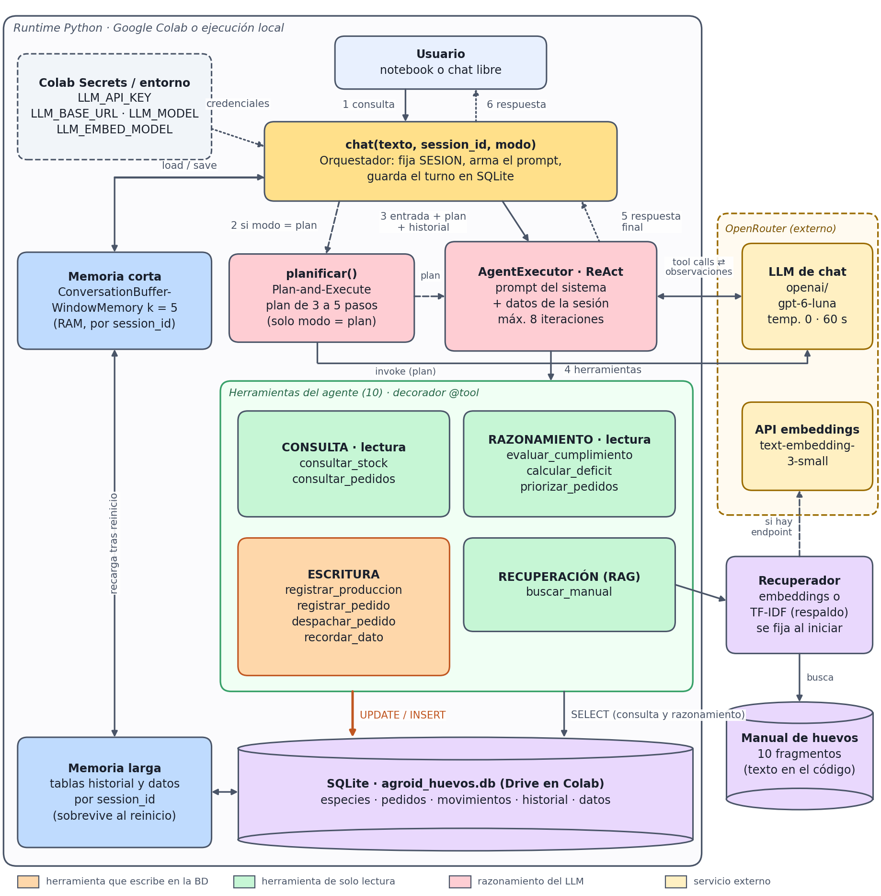
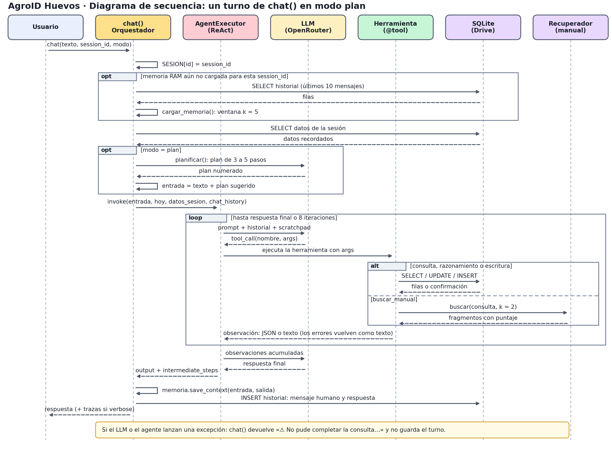
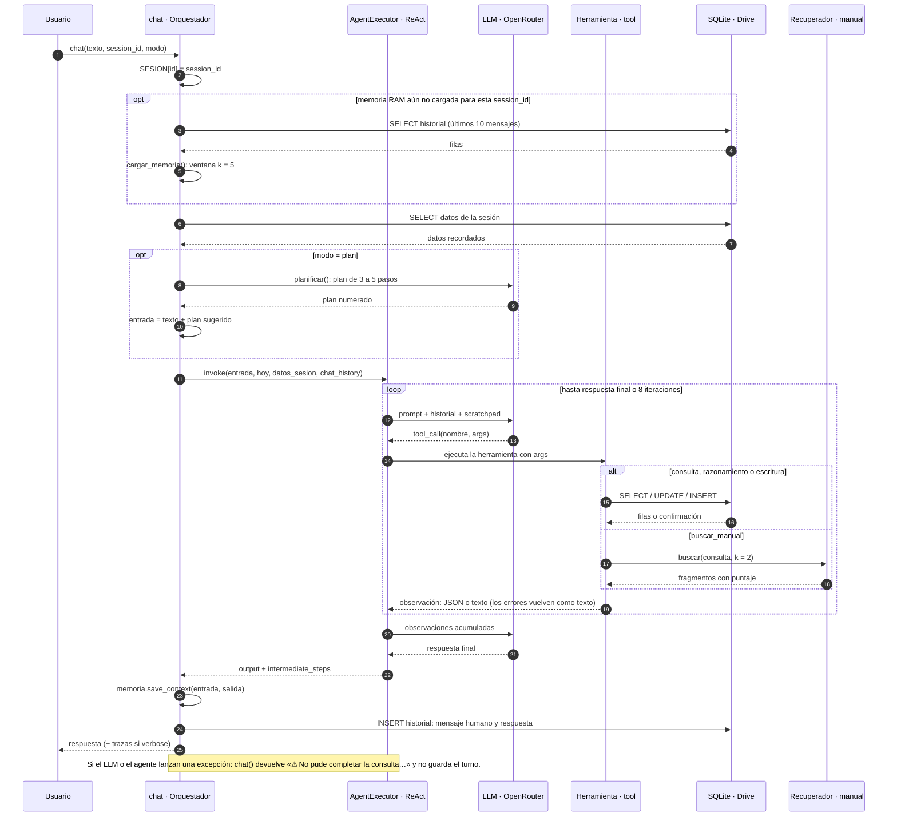

# AgroID Huevos - Agente de gestión de inventario

Proyecto de la Evaluación Parcial 2 de ISY0101. El cuaderno implementa un agente conversacional en español para consultar y actualizar inventario de huevos, revisar pedidos, calcular déficits, priorizar entregas y recuperar información de un manual.

**Integrantes:** Esteban Pacheco Vega y Javier Perez Mora  
**Sección:** 007D  
**Punto de entrada:** [`AgroID_Huevos_Agente_EP2.ipynb`](AgroID_Huevos_Agente_EP2.ipynb)

> Esta carpeta contiene una implementación basada en notebook para Google Colab. Los datos de inventario son simulados. No usar para gestionar una operación avícola real sin validación de datos, reglas y contenido técnico.

## Funcionalidades

- **Consulta:** inventario por especie y pedidos por estado.
- **Escritura:** registrar producción, crear y despachar pedidos, y guardar datos que el usuario solicita recordar.
- **Razonamiento:** evaluar cumplimiento de una cantidad, calcular déficit y ordenar pedidos por fecha límite.
- **Recuperación:** `buscar_manual` consulta diez fragmentos temáticos. Intenta embeddings; si el endpoint no está disponible, informa y usa TF-IDF, que busca coincidencias léxicas.
- **Memoria:** ventana conversacional de cinco interacciones en RAM, reconstruible desde SQLite; los datos explícitos recordados se almacenan por `session_id`.
- **Planificación:** modo ReAct y modo `plan`, que propone pasos antes de la ejecución. El agente puede usar hasta ocho iteraciones por consulta.

## Arquitectura y flujo

### Componentes



- **Orquestación:** `chat(texto, session_id, modo)` coordina memoria, planificador y agente. `AgentExecutor` (LangChain) decide qué herramienta usar en cada iteración, con un máximo de ocho.
- **LLM y embeddings:** se consumen vía OpenRouter (`LLM_BASE_URL`, `LLM_MODEL`, `LLM_EMBED_MODEL`); las credenciales salen de Colab Secrets.
- **Herramientas:** diez funciones `@tool`. Las de consulta y razonamiento solo leen SQLite; las de escritura (naranja en el diagrama) modifican stock, pedidos, movimientos y datos recordados; `buscar_manual` usa el Recuperador.
- **Memoria:** corta en RAM (ventana k = 5) y larga en SQLite (`historial` y `datos`, por `session_id`).
- **Persistencia:** `agroid_huevos.db` con cinco tablas. En Colab se crea en `MyDrive/AgroID_Huevos` para sobrevivir al reinicio del runtime; en ejecución local, en `./datos_agroid`.

### Secuencia de un turno (modo `plan`)



1. `chat` fija el `session_id` activo (lo usa `recordar_dato`) y, si la ventana en RAM no existe, la reconstruye con los últimos diez mensajes de `historial`.
2. Lee los datos recordados de esa sesión.
3. En modo `plan`, una llamada al LLM devuelve un plan de tres a cinco pasos que se agrega a la entrada como sugerencia. No se vuelve a pedir durante la ejecución.
4. El agente repite el ciclo ReAct: el LLM elige una herramienta, esta lee o escribe en SQLite (o busca en el manual) y la observación vuelve al LLM, hasta la respuesta final o ocho iteraciones.
5. `chat` actualiza la ventana en RAM, guarda el mensaje humano y la respuesta en `historial` y responde. Si el LLM o el agente fallan, devuelve un aviso (máximo 200 caracteres) y **no guarda el turno**.

<details>
<summary>Código Mermaid del mismo diagrama (GitHub lo renderiza; fuente en <code>docs/diagrama_secuencia.mmd</code>)</summary>



</details>

## Catálogo técnico de herramientas

El catálogo coincide con `TOOLS` del notebook. Las firmas son los argumentos que el framework expone al modelo. Las cantidades representan unidades enteras de huevos; las fechas se calculan con el reloj del entorno donde corre el notebook.

### Consulta

| Herramienta / firma | Comportamiento y resultado | Límites y errores |
|---|---|---|
| `consultar_stock(especie="todas")` | Con `todas`, `todo`, `todos` o cadena vacía devuelve una lista JSON de `{especie, stock, huevos_dia}`. Con especie devuelve la fila correspondiente. Reconoce nombres y variantes por raíz, sin distinguir mayúsculas ni acentos. | Especies admitidas: gallina, codorniz, pato, ganso y guinea. Si no reconoce la raíz devuelve mensaje de error. No cambia datos. |
| `consultar_pedidos(estado="pendiente")` | Lista pedidos, con `id`, cliente, especie, cantidad, fecha límite y estado, ordenados por fecha límite. `estado="todos"` trae todos. | Estados funcionales del esquema: `pendiente` y `cumplido`; otro texto devuelve lista vacía/mensaje sin coincidencias. No cambia datos. |

### Escritura

| Herramienta / firma | Comportamiento y resultado | Validaciones y efectos |
|---|---|---|
| `registrar_produccion(especie, cantidad)` | Suma cantidad al stock y crea fila en `movimientos` con delta positivo y motivo `producción`. Devuelve cantidad ingresada y stock final. | Especie reconocida; cantidad entera de 1 a 100.000. Entrada inválida informa error y no modifica stock. |
| `registrar_pedido(cliente, especie, cantidad, dias_plazo)` | Crea pedido pendiente con fecha límite `hoy + dias_plazo`; devuelve ID generado y resumen. | Cliente no vacío; especie reconocida; cantidad entera > 0; plazo entero ≥ 0. Cantidad no tiene máximo explícito en esta función. No reserva stock. |
| `despachar_pedido(pedido_id)` | Para un pedido pendiente con stock suficiente, resta unidades del inventario, cambia su estado a `cumplido`, registra movimiento negativo y devuelve saldo. | Pedido existente, aún pendiente, stock ≥ cantidad. Si falla la precondición no se despacha. El despacho se limita a la especie del pedido. |
| `recordar_dato(clave, valor)` | Inserta o reemplaza un dato en `datos`, asociado al `session_id` que `chat()` establece antes de cada turno. | Clave recortada a 60 caracteres y valor a 300. Solo es visible dentro de la misma sesión; no constituye memoria compartida entre sesiones. |

### Razonamiento con datos del inventario

| Herramienta / firma | Regla aplicada | Lectura correcta del resultado |
|---|---|---|
| `evaluar_cumplimiento(cantidad_requerida, especies, dias=0)` | Acepta especies separadas por coma o por ` y `; deduplica especies reconocidas. Calcula stock total actual y stock más `huevos_dia × dias`. Un `dias` negativo se convierte en cero. | Devuelve `cumple_solo_con_stock`, `cumple_con_produccion`, déficits contra ambas disponibilidades y detalle por especie. La producción es una proyección lineal; no se descuenta demanda de otros pedidos. |
| `calcular_deficit(dias=0)` | Suma demanda de todos los pedidos pendientes por especie. Si `dias > 0`, usa ese horizonte para todas las especies; con `dias=0`, toma por especie el mayor plazo restante entre sus pedidos. Compara la demanda agregada con stock y stock más producción al horizonte. | Devuelve demanda, stock, horizonte, disponibilidad proyectada, déficit actual y proyectado. Es una comparación agregada por especie, no una asignación pedido por pedido. No incluye pedidos cumplidos. |
| `priorizar_pedidos()` | Ordena pedidos pendientes por fecha límite ascendente y luego cantidad ascendente. Recorre ese orden y calcula capacidad por especie como `stock + huevos_dia × días_restantes`. Descuenta de la capacidad las unidades ya asignadas a pedidos anteriores de la misma especie. | Cada pedido queda como `cumplible`, `parcial` o `no cumplible`, con `faltante`. Es una heurística voraz y no asigna sustituciones entre especies. La fecha pasada tiene cero días de producción proyectada. |

### Recuperación desde el manual

| Herramienta / firma | Comportamiento | Interpretación y límites |
|---|---|---|
| `buscar_manual(consulta)` | Busca entre diez fragmentos sobre conservación, equivalencias, postura, planificación, bioseguridad, incubación y registro. Devuelve hasta dos fragmentos con puntuación o mensaje de que no hay coincidencias. | Intenta embeddings del modelo configurado; ante cualquier error en inicialización usa TF-IDF. TF-IDF es léxico. Una puntuación no es probabilidad ni garantía de veracidad. El manual no incluye referencias por fragmento y debe ser validado por los integrantes. |

### Normalización y formato de errores

La normalización de especie convierte a minúsculas, elimina diacríticos y busca subcadenas en este orden: `guinea`, `codorn`, `gallin`, `pato`, `gans`. De este modo “gallina de guinea” se mapea a `guinea`. Un texto que contenga más de una raíz se resuelve con la primera coincidencia; no usar frases ambiguas como parámetro de especie. Errores de validación de argumentos de LangChain se transforman en texto con rutas de campo y mensaje de validación. Las herramientas capturan errores de ejecución y devuelven texto; esto evita que varios errores esperados detengan el agente, pero no reemplaza el manejo transaccional de base de datos.

## Esquema persistente y datos de demostración

| Tabla | Clave/columnas relevantes | Uso |
|---|---|---|
| `especies` | `nombre` (PK), `stock`, `huevos_dia` | Inventario inicial: gallina 800/300; codorniz 1.500/400; pato 200/40; ganso 20/3; guinea 60/10. |
| `pedidos` | `id` (autoincremental), `cliente`, `especie`, `cantidad`, `fecha_limite`, `estado` | Cuatro pedidos pendientes iniciales: Don Pepe 600 gallina/2 días; La Espiga 1.200 gallina/5 días; Mayorista Andes 2.000 codorniz/4 días; Hotel Costa 150 pato/3 días. |
| `movimientos` | `id`, fecha, especie, delta, motivo | Registra producción y despachos ejecutados por las herramientas. |
| `historial` | `id`, `session_id`, rol, contenido | Conserva cada mensaje humano y salida del agente para restaurar contexto. |
| `datos` | `(session_id, clave)` como PK, `valor` | Hechos pedidos explícitamente para recordar, aislados por sesión. |

El valor `huevos_dia` se carga como dato de ejemplo y el agente lo multiplica directamente por días; no calcula producción desde número de aves ni tasas anuales. Al iniciar la demo `inicializar_bd(reset=True)` borra la base seleccionada y vuelve a crear datos iniciales. La misma llamada aparece en la celda de escenarios; por tanto, ejecutar esa celda reinicia la base apuntada por `CFG["db"]`.

## Ejecución en Google Colab

1. Abrir el notebook en Colab y ejecutar las celdas en orden.
2. En **Secrets** de Colab, crear `LLM_API_KEY` y habilitar su acceso al notebook. No escribir la clave en el cuaderno ni compartirla en salidas.
3. Opcionalmente configurar `LLM_BASE_URL` (por defecto `https://openrouter.ai/api/v1`), `LLM_MODEL` (por defecto `openai/gpt-6-luna`) y `LLM_EMBED_MODEL` (por defecto `openai/text-embedding-3-small`).
4. Aceptar el montaje de Google Drive.
5. Ejecutar las pruebas directas de herramientas y, si se dispone de API key/créditos, los ocho escenarios con el modelo real. La celda final ofrece chat libre.
6. Registrar las versiones usadas en esa ejecución (ver más abajo) y guardar la salida completa de los escenarios.

La demostración con modelo real consume solicitudes/créditos. Para ejecutar solo las pruebas del notebook sin depender de un LLM, usar el test simulado que se describe abajo. No ejecutar la celda de escenarios sobre una base de datos con información que se deba conservar: inicializa la base de demostración con `reset=True`.

## Ejecución de prueba simulada

En una instalación local de Python, instala las dependencias usadas por el cuaderno y el test:

```powershell
python -m pip install langchain langchain-openai langchain-classic scikit-learn openai nbformat
```

Luego ejecuta:

```powershell
python tests/test_agente_llm_simulado.py AgroID_Huevos_Agente_EP2.ipynb
```

El test sustituye el modelo por reglas fijas y fuerza el respaldo TF-IDF. No necesita credenciales ni llamadas de red. Comprueba la ejecución de las herramientas, que ciertas escrituras ocurran, el rechazo de entradas inválidas, memoria SQLite, restauración de ventana, separación por sesión y manejo de una excepción del LLM. No mide la calidad de respuesta ni la selección de herramientas de un modelo real.

### Versiones y reproducibilidad

El 20 de octubre de 2026 el test se ejecutó en un entorno limpio y terminó con todas las verificaciones aprobadas. Versiones que resolvió pip ese día:

| Componente | Versión |
|---|---|
| Python | 3.12.3 |
| langchain / langchain-core | 1.4.6 / 1.6.12 |
| langchain-classic / langchain-openai | 1.0.8 / 1.7.2 |
| openai / scikit-learn / numpy | 3.35.1 / 1.9.1 / 2.5.4 |

Son las de ese entorno, no necesariamente las de Colab. Para registrar las de su ejecución real, el equipo puede correr `pip list | grep -iE "langchain|openai|scikit|numpy"` (en Colab: `!pip list | grep -iE "langchain|openai|scikit|numpy"`) y reemplazar la tabla. Los plazos que imprime la ejecución dependen del día: en esa corrida los pedidos a uno y dos días aparecieron como `2026-10-21` y `2026-10-22`.

## Escenarios incluidos

| # | Caso | Evidencia que aporta |
|---|---|---|
| 1 | Pedido de 1.800 huevos de codorniz y pato a cinco días | Evaluación con stock disponible y producción proyectada |
| 2-3 | Registrar 500 huevos de gallina y consultar déficit | Escritura seguida de consulta sobre el estado actualizado |
| 4 | Priorizar pedidos y consultar almacenamiento de codorniz | Secuencia de herramientas y recuperación desde el manual |
| 5 | Recordar una preferencia del Hotel Costa | Persistencia explícita por sesión |
| 6 | Especie no reconocida y cantidad negativa | Respuesta de error sin modificar stock |
| 7 | Ingresar pedido urgente de Clínica Sur | Actualización de pedido y nueva priorización |
| 8 | Continuar después de limpiar memoria RAM | Recuperación desde SQLite con el mismo `session_id` |

## Revisión de evidencia y límites

La evidencia guardada en [`tests/evidencia_pruebas.txt`](tests/evidencia_pruebas.txt) corresponde a una ejecución **con LLM simulado**. En esa ejecución los embeddings fallaron por `ConnectionError` y se usó TF-IDF. El archivo muestra los casos y las verificaciones reportadas como pasadas, pero no constituye una demostración del comportamiento del modelo real.

Antes de entregar, el equipo debe capturar y revisar una ejecución real en Colab que muestre salidas completas y legibles para cada escenario, incluyendo herramientas invocadas y respuestas. No presentar los textos `[SIM]` como respuestas del modelo real. Las fechas de la evidencia guardada son relativas al día en que se ejecutó (los pedidos a dos y cinco días aparecen con plazo `2026-10-20` y `2026-10-23`; el urgente a un día aparece como `2026-10-19`), por lo que son una captura histórica y no deben leerse como fechas actuales.

Otros límites visibles en la implementación:

- Datos y manual de ejemplo; TF-IDF no es búsqueda semántica; el orden voraz por fecha no optimiza la asignación de stock entre pedidos.
- La variable `SESION` representa una sesión activa global: una sola sesión a la vez.
- El docstring de `recordar_dato` (lo que lee el LLM) dice que el dato "persiste entre sesiones", pero la implementación lo guarda por `session_id`. Conviene ajustar el texto del docstring para que el agente no prometa más de lo que hace.
- El agente usa `langchain_classic`, `ConversationBufferWindowMemory` e `InMemoryChatMessageHistory`, que LangChain marca como obsoletos (avisos en la evidencia). Funcionan hoy, pero habría que migrar a `create_agent` con checkpointing antes de LangChain 2.0.
- El modo de recuperación (embeddings o TF-IDF) se decide al iniciar; si el endpoint falla después, `buscar_manual` devuelve un mensaje de error en vez de cambiar de modo.
- El manual contiene afirmaciones referenciales que deben ser contrastadas con fuentes técnicas antes de usarse como consejo operativo.

## Documentos del proyecto

- [`docs/INFORME_TECNICO.md`](docs/INFORME_TECNICO.md): fuente editable del informe técnico, con el catálogo de contratos, cálculos, arquitectura, secuencia, decisiones y referencias. Las secciones de autoría exclusiva del equipo están marcadas como pendientes.
- [`docs/INFORME_TECNICO.pdf`](docs/INFORME_TECNICO.pdf): versión PDF del informe, de cinco páginas (una de ellas horizontal para el diagrama de secuencia), que es el máximo de la pauta.
- [`docs/MATRIZ_CUMPLIMIENTO.md`](docs/MATRIZ_CUMPLIMIENTO.md): correspondencia entre indicadores, evidencia existente y trabajo pendiente.
- [`docs/GUIA_SECCIONES_7_Y_8.md`](docs/GUIA_SECCIONES_7_Y_8.md): apoyo para redactar la argumentación y las reflexiones, checklist previo a la entrega y guion de demostración. No forma parte de la entrega.
- [`docs/diagrama_arquitectura.png`](docs/diagrama_arquitectura.png), [`docs/diagrama_secuencia.png`](docs/diagrama_secuencia.png) y [`docs/diagrama_secuencia.mmd`](docs/diagrama_secuencia.mmd): diagramas de componentes y de secuencia (este último también en Mermaid).
- [`docs/generar_diagramas.py`](docs/generar_diagramas.py): fuente editable de ambos diagramas.
- [`docs/generar_informe_pdf.py`](docs/generar_informe_pdf.py): convierte `INFORME_TECNICO.md` en PDF y avisa si supera cinco páginas.
- [`tests/test_agente_llm_simulado.py`](tests/test_agente_llm_simulado.py): prueba automatizada con LLM falso.
- [`tests/evidencia_pruebas.txt`](tests/evidencia_pruebas.txt): salida registrada de esa prueba; leer con las limitaciones anteriores.

### Regenerar diagramas e informe

Desde la carpeta `docs/`, con `matplotlib`, `reportlab`, `Pillow` y `pypdf` instalados (y la fuente DejaVu Sans):

```bash
python generar_diagramas.py        # actualiza los dos PNG y el .mmd
python generar_informe_pdf.py      # regenera el PDF desde INFORME_TECNICO.md
```

El diagrama de secuencia se edita en la lista `EVENTOS` de `generar_diagramas.py` y el de arquitectura en la función `arquitectura()`. Si cambias el código del notebook (herramientas, memoria, planificador), actualiza también los diagramas.

## Pendientes del equipo para la evaluación

La pauta reserva al equipo la autoría de las justificaciones técnicas, las conclusiones y las reflexiones individuales. Esos textos no se completan aquí:

- **Informe, sección 7:** la tabla de decisiones ya describe qué se hizo y qué límite tiene; falta la argumentación del equipo de por qué cada decisión es adecuada.
- **Informe, sección 8:** una conclusión y reflexión individual por integrante.
- **Declaración de IA (sección 9):** ya incluye a OpenAI Codex y a Claude para la documentación; el equipo debe agregar cualquier otra herramienta usada en el notebook y confirmar que la frase sobre autoría de las secciones 7 y 8 sea cierta al entregar.
- Ejecución real en Colab con salidas completas, validación de las fuentes del manual y preparación de la presentación oral con participación de ambos integrantes y demo en vivo. Los documentos escritos por sí solos no prueban esos aspectos de presentación.

## Referencias de software

Las referencias con formato APA se listan en el informe técnico. La documentación enlazada describe las herramientas; no valida por sí misma los datos avícolas incluidos en el manual.
