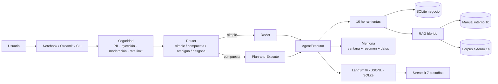

# Arquitectura EFT — AgroID Huevos

**Proyecto:** AgroID Huevos · **Asignatura:** ISY0101 · **Entrega:** EFT  
**Integrantes:** Esteban Pacheco Vega y Javier Perez Mora · **Sección:** 007D

## 1. Vista de componentes



## 2. Flujo de un turno

1. `run_turn` redacta PII y crea el estado del turno.
2. Escanea inyección y moderación; si hay bloqueo, registra el evento y no llama al LLM.
3. Aplica rate limiting por sesión y global.
4. Clasifica la consulta y elige `react` o `plan`.
5. Carga memoria: ventana, resumen y datos por sesión.
6. Prepara el presupuesto de contexto (entrada, historial, fragmentos).
7. En modo plan, genera el plan con objetivo, pasos, criterios y fallback.
8. `AgentExecutor` ejecuta el ciclo ReAct; cada herramienta deja span y evento.
9. El monitor revisa observaciones y decide continuar, replanificar o cerrar.
10. El crítico revisa cifras y citas; el output guard bloquea fuga del prompt.
11. Guarda el turno en SQLite y actualiza el resumen.
12. Persiste traza, spans, tokens, costo, anomalías y fuentes.
13. El dashboard lee SQLite y LangSmith para auditar.

## 3. Jerarquía de trazas

```text
Session ID (metadata.session_id)
└── Trace ID (LangSmith / trace_id interno de 32 hex)
    └── Span raíz: chat
        ├── Span: planificar (modo plan)
        │   └── Span LLM
        ├── Span LLM (iteración ReAct 1)
        ├── Span Tool (consultar_stock)
        ├── Span LLM (iteración ReAct 2)
        ├── Span Tool (buscar_manual)
        │   └── Span Retriever (RAG + integridad)
        ├── Span LLM (respuesta final)
        └── Span Crítico / Monitor (si aplica)
```

| Concepto | Dónde se obtiene |
|---|---|
| Session ID | `session_id` de `run_turn`; metadata de LangSmith. |
| Trace ID | `trace_id` de LangSmith; `trace_id` interno en JSONL/SQLite. |
| Span ID | `run_id` de LangSmith; `span_id` local. |
| Parent Span ID | `parent_run_id` de LangSmith; `parent_span_id` local. |

## 4. Modelo de datos de observabilidad

| Tabla | Contenido |
|---|---|
| `runs` | Corridas de benchmark y metadatos. |
| `traces` | Turno: estado, latencia, tokens, costo, seguridad, plan, RAG, crítico. |
| `spans` | Árbol local: chain, llm, tool, retriever. |
| `llm_calls` | Tokens, modelo real, costo, latencia, TTFT, throughput. |
| `tool_calls` | Herramienta, argumentos, resultado, estado, duración. |
| `security_events` | Inyección, PII, rate limit, integridad, moderación. |
| `evaluations` | Métricas por caso: tools, args, facts, groundedness, citas, modo, replans. |
| `manual_integrity` | Verificaciones de manifiesto. |
| `langsmith_runs` | Caché exportada de LangSmith. |
| `ttft_measurements` | TTFT, tokens/s, ms/token. |

## 5. RAG híbrido

- **Fuente interna:** `data/manual.json` (10 fragmentos).
- **Fuente externa:** `data/external_corpus.json` (14 fragmentos citados).
- **Integridad:** manifiesto SHA-256 y HMAC opcional; fragmentos alterados se excluyen.
- **Indexación:** embeddings si hay API key; TF-IDF como respaldo.
- **Recuperación:** top-k por corpus, umbral, balance interno/externo, deduplicación.
- **Citas:** `[Mxx]` / `[Exx]`, título, autor, año y URL.
- **Evaluación:** recall@3, mezcla de fuentes, latencia, cobertura de citas.

## 6. Planificación adaptativa

- **Clasificador:** simple, compuesta, ambigua, riesgosa.
- **Plan:** objetivo, pasos, herramienta, argumentos, criterio de éxito, fallback.
- **Monitor:** errores, pasos faltantes, respuesta vacía, riesgo.
- **Decisión:** continuar, replanificar o cerrar.
- **Regla de oro:** una replanificación por turno y nunca se reintenta una escritura exitosa.
- **Crítico:** cifras sin respaldo y citas faltantes.

## 7. Seguridad

| Control | Implementación |
|---|---|
| PII | RUT, email, teléfono y tarjetas redactados antes del LLM, logs y trazas. |
| Inyección | Patrones ponderados, delimitadores, política de herramientas. |
| Rate limiting | Ventana por minuto, cuota diaria, concurrencia máxima. |
| Integridad RAG | SHA-256 + HMAC; exclusión de fragmentos alterados. |
| Moderación | Categorías dañinas y tema ajeno. |
| Límites | 8 iteraciones, 3 escrituras, 2.000 caracteres, 800 tokens. |
| Fuga de prompt | `leaks_system_prompt` y reemplazo de respuesta. |

## 8. Decisiones y límites

- LangSmith es la fuente principal de trazas; JSONL y SQLite son el respaldo reproducible.
- Los modelos free tienen límites de cuota y rotación; se usa modelo fijado para evaluar.
- `openrouter/free` enruta aleatoriamente; se compara con modelo fijado.
- El rate limiter es en memoria; en producción debería usar Redis.
- SQLite con WAL no reemplaza PostgreSQL para múltiples réplicas.
- TF-IDF es respaldo léxico, no búsqueda semántica.
- La confirmación humana en escrituras de alto valor es una brecha declarada.
- El prototipo no es productivo; requiere autenticación, retención, SLA y validación legal/sanitaria.
