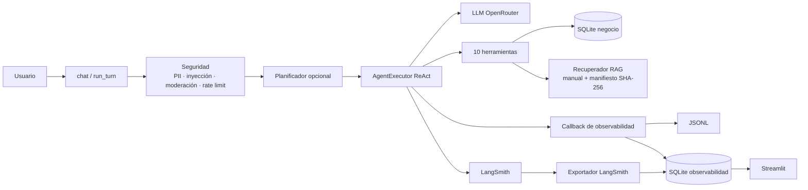

# AgroID Huevos — Arquitectura de observabilidad EP3

**ISY0101 Ingeniería de Soluciones con IA**  
**Integrantes:** Esteban Pacheco Vega y Javier Perez Mora  
**Sección:** 007D

## 1. Componentes



## 2. Jerarquía de trazas

LangSmith asigna el árbol nativo. El proyecto añade IDs de correlación para los logs y la base local.

```text
Session ID (metadata.session_id)
└── Trace ID (LangSmith / trace_id interno de 32 hex)
    └── Span raíz: chat (run_id)
        ├── Span: agroid.planificar (modo plan)
        │   └── Span LLM
        ├── Span LLM (iteración ReAct 1)
        ├── Span Tool (consultar_stock)
        ├── Span LLM (iteración ReAct 2)
        ├── Span Tool (buscar_manual)
        │   └── Span Retriever (recuperación + integridad)
        └── Span LLM (respuesta final)
```

| Concepto | Dónde se obtiene |
|---|---|
| Session ID | `session_id` de `run_turn`; metadata de LangSmith |
| Trace ID | `trace_id` de LangSmith; `trace_id` interno de 32 hex en JSONL/SQLite |
| Span ID | `run_id` de LangSmith; `span_id` local |
| Parent Span ID | `parent_run_id` de LangSmith; `parent_span_id` local |

## 3. Modelo de datos de observabilidad

| Tabla | Contenido |
|---|---|
| `runs` | Corridas de benchmark y metadatos |
| `traces` | Un turno: estado, latencia, tokens, costo, seguridad, anomalías |
| `spans` | Árbol local: `chain`, `llm`, `tool`, `retriever` |
| `llm_calls` | Tokens, modelo real, costo, latencia, TTFT, throughput |
| `tool_calls` | Herramienta, argumentos, resultado, estado, duración |
| `security_events` | Inyección, PII, rate limit, integridad, moderación |
| `evaluations` | Métricas por caso: herramientas, argumentos, hechos, groundedness |
| `manual_integrity` | Verificaciones del manifiesto del manual |
| `langsmith_runs` | Caché exportada de LangSmith para el dashboard |
| `ttft_measurements` | TTFT, tokens/s y ms/token con streaming |

## 4. Flujo de un turno

1. `run_turn` redacta PII y crea el estado del turno.
2. Escanea inyección y moderación; si hay bloqueo, registra el evento y no llama al LLM.
3. Aplica rate limiting por sesión y global.
4. Ejecuta `_chat_traced`, decorado con `@traceable`, y el `AgentExecutor`.
5. El callback captura cada LLM y herramienta; `buscar_manual` añade el span `retriever`.
6. Al finalizar, detecta bucles, deriva, cambios de modelo y cuellos de botella.
7. Persiste la traza en SQLite y escribe eventos JSONL.
8. El dashboard lee SQLite; LangSmith conserva el árbol completo.

## 5. Controles de seguridad

| Control | Implementación |
|---|---|
| PII | RUT, email, teléfono y tarjetas (Luhn) redactados antes del LLM, LangSmith, logs e historial |
| Prompt injection | Patrones ponderados, delimitadores, política de herramientas y bloqueo de salida con fuga del prompt |
| Rate limiting | Ventana por minuto por sesión y global, cuota diaria y concurrencia máxima |
| Integridad RAG | SHA-256 por fragmento + HMAC opcional; fragmentos alterados se excluyen |
| Data poisoning | Verificación en cada recuperación y evento de seguridad |
| Moderación | Categorías dañinas y detección de tema ajeno |
| Límites del agente | 8 iteraciones, 3 escrituras por turno, 2.000 caracteres de entrada, 800 tokens de salida |
| Explicabilidad | `trace_id` por respuesta, waterfall y detalle de herramientas en el dashboard |

## 6. Decisiones y límites

- LangSmith es la fuente principal de trazas; los logs JSON y SQLite son el respaldo reproducible.
- Los modelos gratuitos de OpenRouter tienen límites de 20 req/min y 50 req/día si se compraron menos de 10 créditos. El runner controla la cuota.
- `openrouter/free` enruta aleatoriamente entre modelos gratuitos; por eso el experimento compara router vs modelo fijado.
- El rate limiter es en memoria; en producción debería usar Redis.
- SQLite con WAL mejora la concurrencia, pero no reemplaza PostgreSQL para múltiples réplicas.
- TF-IDF es el respaldo cuando los embeddings no están disponibles; no es búsqueda semántica.
