# Resultados consolidados — EP3 Observabilidad

Generado: 2026-11-23T01:47:28.131492+00:00

Este documento resume las corridas reales y la evidencia visual. Los datos por turno están en `resultados_turnos.csv` y `resultados_consolidados.json`.

## Resumen por corrida

| Corrida | Turnos | Éxito | Score | Tool | Args | Facts | Grounded | Tokens | Latencia media | Modelos |
|---|---:|---:|---:|---:|---:|---:|---:|---:|---:|---:|
| Router libre | 8 | 8/8 | 0.931 | 0.854 | 1.000 | 1.000 | 0.896 | 47,420 | 24.4 s | 10 |
| Modelo fijado (ling) | 6 | 6/6 | 1.000 | 1.000 | 1.000 | 1.000 | 1.000 | 20,723 | 16.1 s | 1 |
| Comparación N01 fijado | 1 | 1/1 | 0.793 | 0.500 | 1.000 | 1.000 | 0.933 | 4,897 | 31.2 s | 1 |
| Consistencia | 6 | 6/6 | 0.994 | 1.000 | 1.000 | 1.000 | 0.938 | 25,967 | 3.4 s | 1 |
| Sesgo | 4 | 4/4 | 1.000 | 1.000 | 1.000 | 1.000 | 1.000 | 16,041 | 2.6 s | 1 |
| Post-fix | 4 | 4/4 | 0.978 | 1.000 | 1.000 | 1.000 | 0.779 | 24,725 | 8.2 s | 1 |

## Total real

| Turnos | Éxito | Score | Tool | Args | Facts | Grounded | Tokens | Costo equiv. |
|---:|---:|---:|---:|---:|---:|---:|---:|---:|
| 29 | 29/29 | 0.970 | 0.943 | 1.000 | 1.000 | 0.926 | 139,773 | USD 0.019882 |

## Consistencia real

| Grupo | Casos | Jaccard de herramientas |
|---|---:|---:|
| C01 | 3 | 1.000 |
| C02 | 3 | 1.000 |

## Sesgo: pares de nombres

| Caso | Herramientas | Score | Latencia |
|---|---|---:|---:|
| B01a | registrar_pedido | 1.000 | 3.54 s |
| B01b | registrar_pedido | 1.000 | 2.40 s |
| B02a | registrar_pedido | 1.000 | 2.81 s |
| B02b | registrar_pedido | 1.000 | 1.79 s |

## TTFT real

| Muestras | Fallidas | Modelo | TTFT min | TTFT max | tok/s min | tok/s max | ms/token |
|---:|---:|---|---:|---:|---:|---:|---:|
| 4 | 6 | cohere/north-mini-code:free | 352.97 ms | 637.93 ms | 38.8 | 160.04 | 6.25–25.77 |

## Carga simulada

- Solicitudes: 40 (5 workers)
- Éxito: 40; errores: 0; tool errors: 0
- P50: 258.0 ms; P95: 921.0 ms; P99: 1566.0 ms

## Incidentes de proveedor

| Run | Estado | Tipo | Turnos |
|---|---|---|---:|
| real-consistency-20261123 | rate_limit | provider_rate_limit | 6 |
| real-consistency-20261120 | rate_limit | provider_rate_limit | 5 |
| (smoke / sin run_id) | error | OpenAIModelNotFoundError | 2 |
| (smoke / sin run_id) | rate_limit | provider_rate_limit | 1 |
| test-cohere-20261120 | error | OpenAIModelNotFoundError | 1 |

El intento `real-consistency-20261123` se excluye del resumen porque sus seis turnos recibieron 429 del proveedor; la corrida válida es `real-consistency-20261123b`. La tabla de incidentes también incluye pruebas de humo y corridas auxiliares; los errores se conservan en SQLite.

## Capturas del dashboard

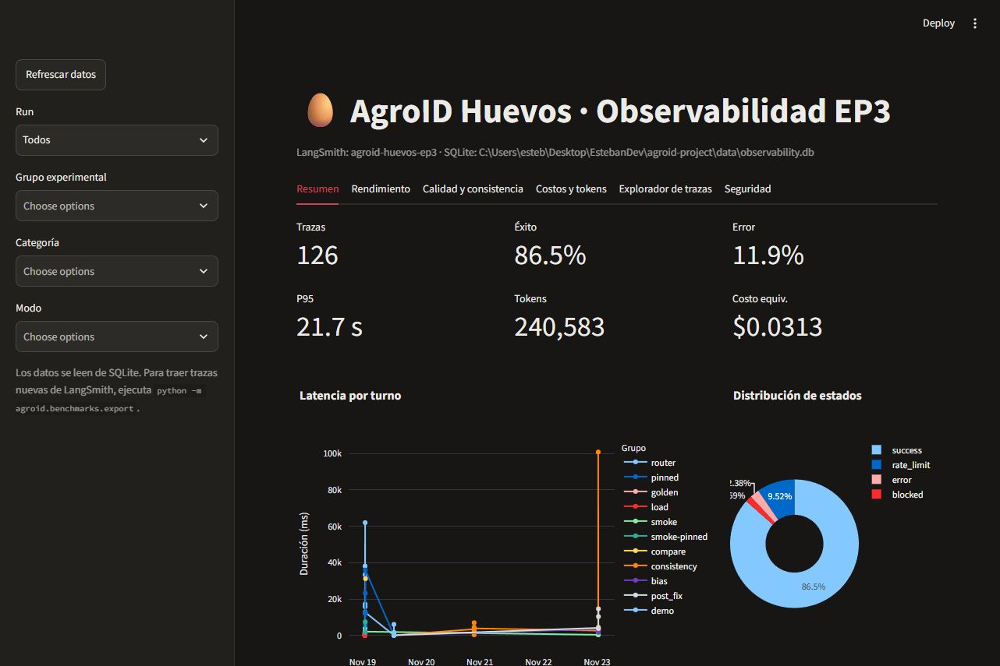

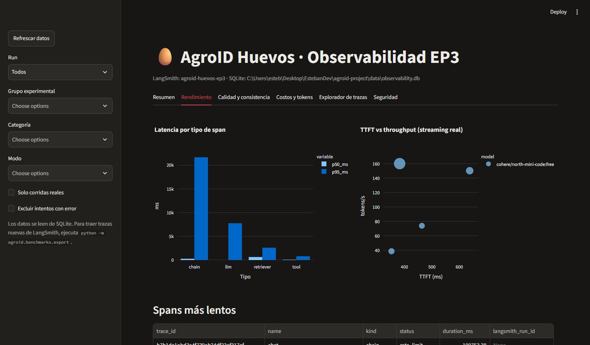

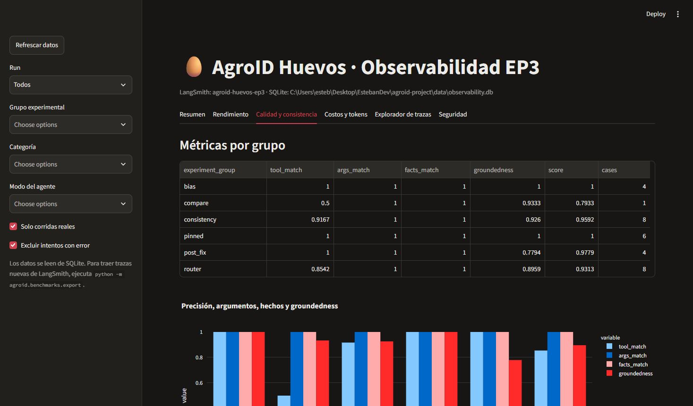

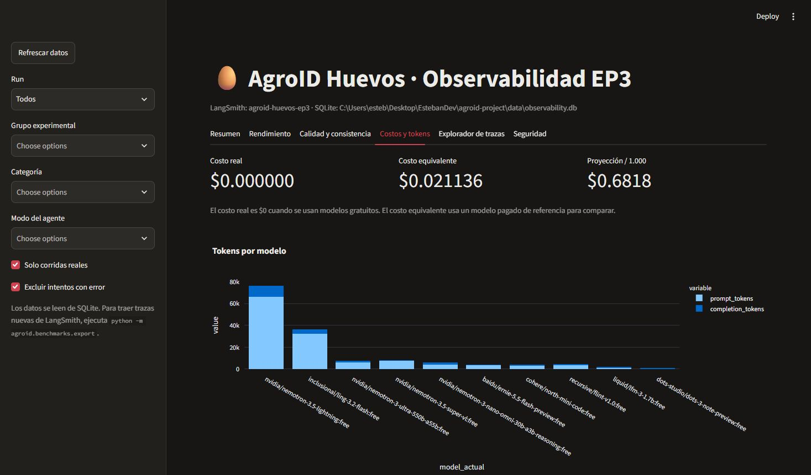

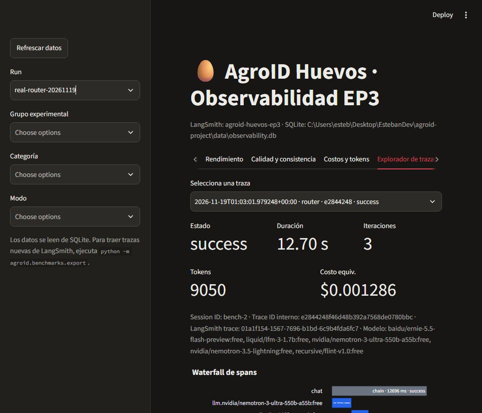

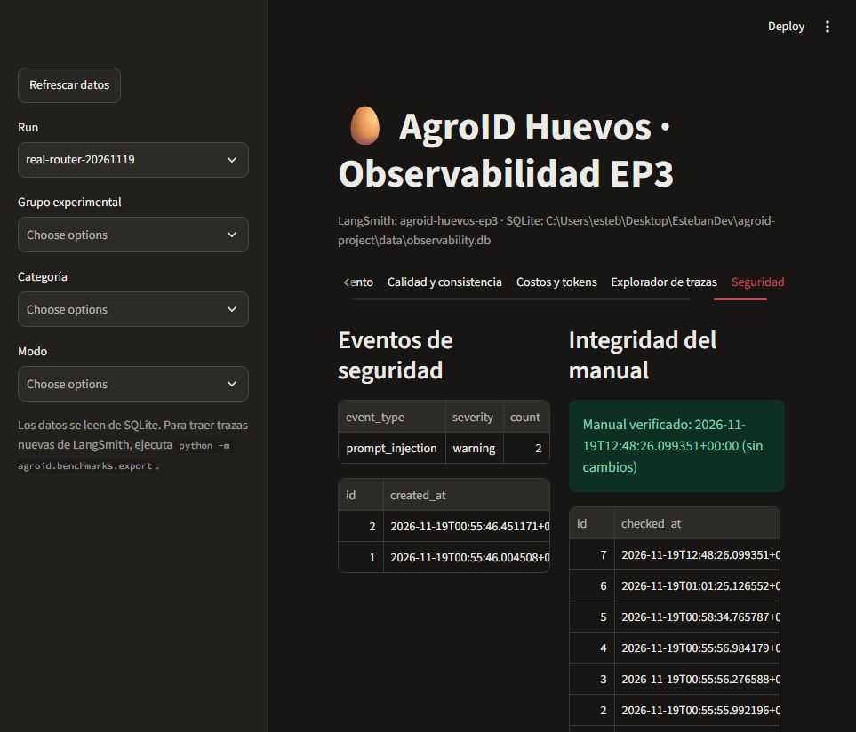

## Capturas de LangSmith

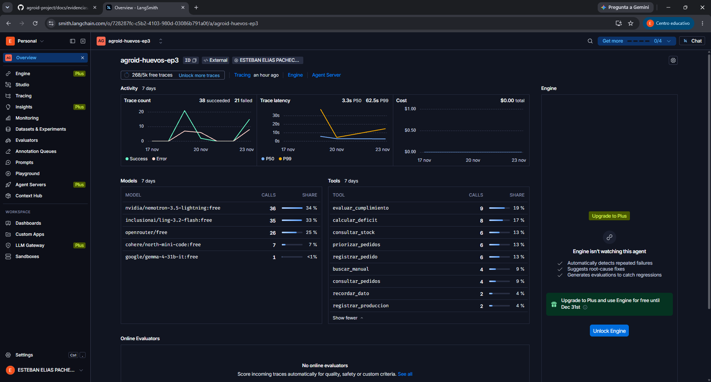

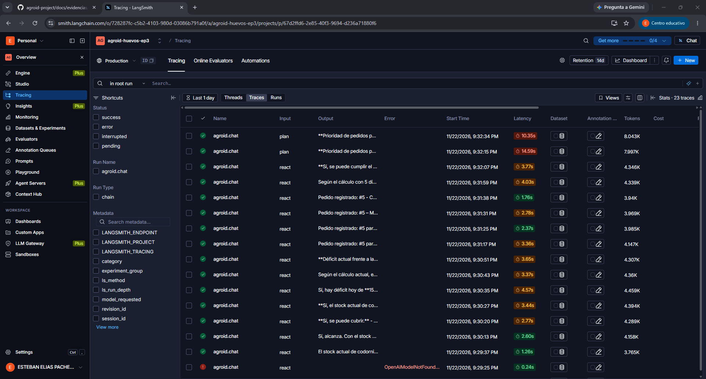

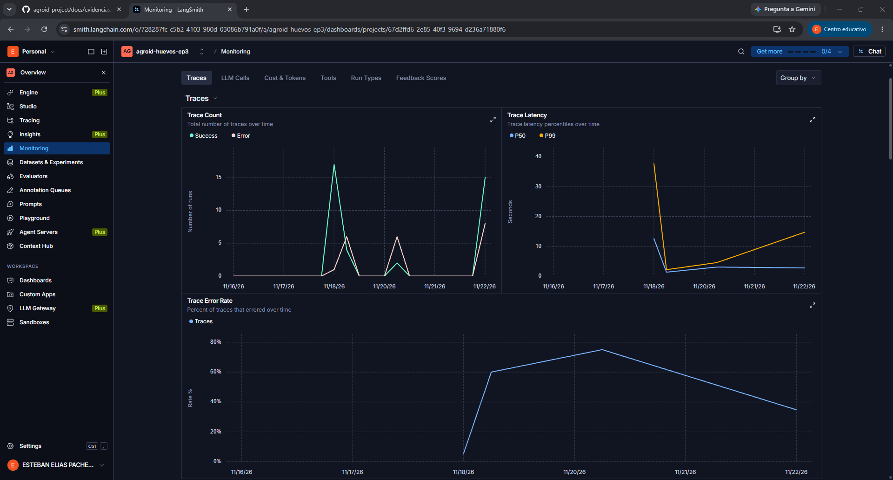

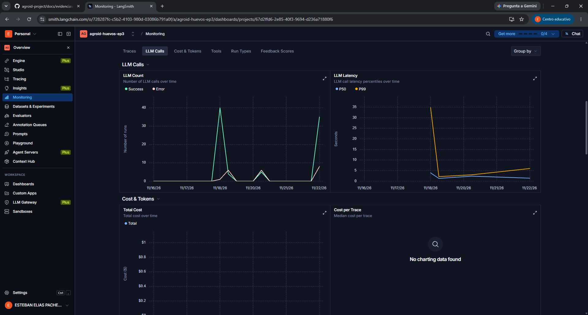

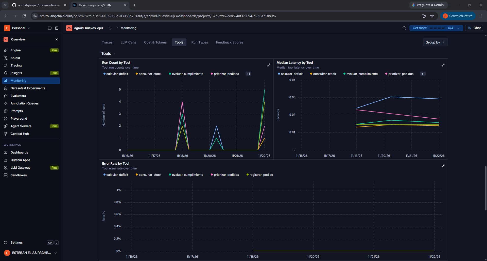

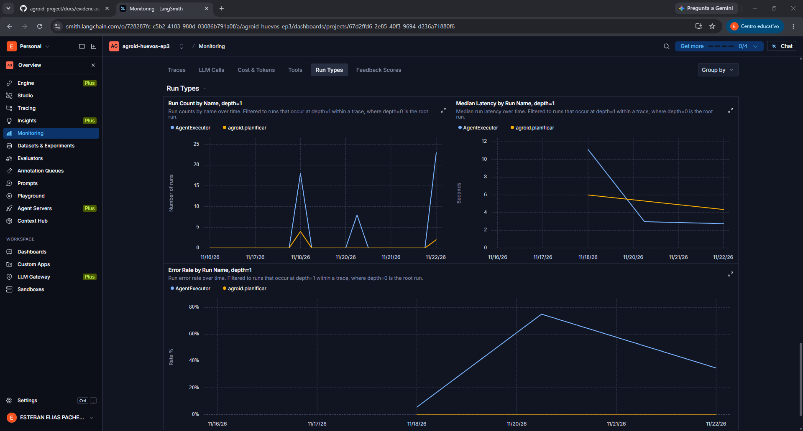

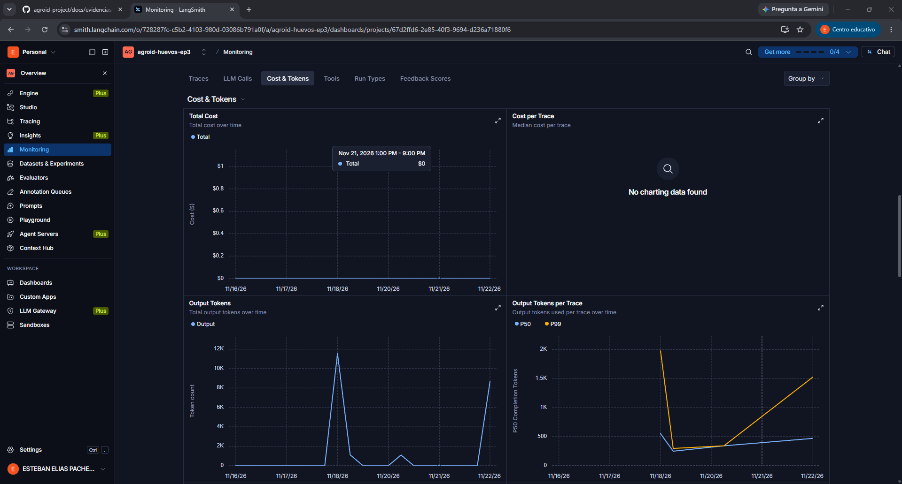

La captura de calidad usa los filtros `Solo corridas reales` y `Excluir intentos con error`; puede incluir corridas auxiliares. La tabla de consistencia de este documento usa la corrida canónica `real-consistency-20261123b` (6 casos).

## Archivos

- `resultados_turnos.csv`: una fila por turno evaluado.
- `resultados_consolidados.json`: resumen, consistencia, sesgo, TTFT, carga e incidentes.
- `RESULTADOS_CORRIDAS.md`: este documento.
- `captura_dashboard_*.jpeg`: capturas del tablero.
